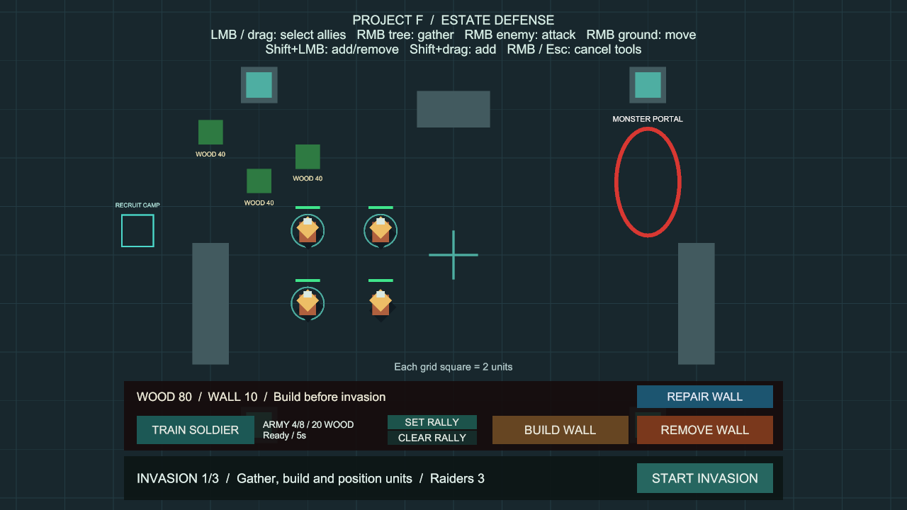
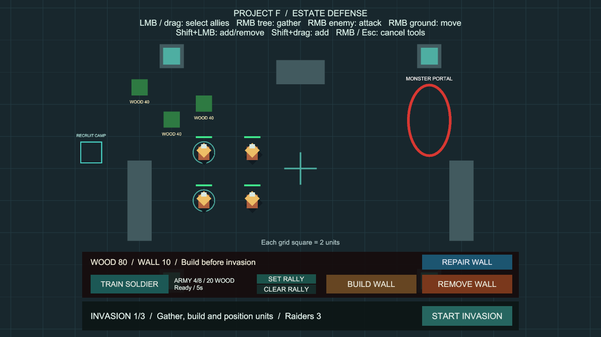

# Shift 추가·해제 선택

상태: 사용자 승인·main 병합 완료. 구현 `428b91d`, main 병합 `2c8ea7c`. 브랜치 `codex/additive-selection`은 집결 지점의 main 병합 `aab0e15`에서 분기했습니다.

## 사용법

추가 준비 없이 **Project F → Open Gameplay → Play**로 실행합니다.

| 조작 | 결과 |
| --- | --- |
| 아군 좌클릭 | 해당 병사 한 명으로 선택을 교체합니다. |
| 좌클릭 드래그 | 범위 안 아군으로 선택을 교체합니다. |
| Shift + 아군 좌클릭 | 미선택 병사를 추가하고, 이미 선택한 병사는 선택에서 뺍니다. |
| Shift + 드래그 | 기존 선택에 범위 안 아군을 더합니다. 중복되거나 선택이 해제되지 않습니다. |
| Shift + 빈 땅·적 클릭 | 기존 선택을 유지합니다. |
| Shift 없이 빈 땅 클릭 | 선택을 모두 해제합니다. |
| 드래그 중 Esc·가운데 버튼 | 진행 중인 선택을 취소하고 이전 선택을 유지합니다. |

왼쪽·오른쪽 Shift를 모두 지원합니다. **좌클릭을 누르기 시작한 시점의 Shift 상태**를 사용하므로 드래그 도중 Shift를 놓아도 추가 선택으로 끝납니다. 반대로 일반 드래그 도중 Shift를 눌러도 해당 드래그는 교체 선택입니다.

선택을 바꾸는 것만으로 기존 이동·공격·채집 명령을 취소하지 않습니다. 이후 우클릭 명령은 최종 선택된 병사에게 적용합니다. Shift + 우클릭도 기존 우클릭과 같습니다. 명령 예약이나 부대 번호 저장은 이번 범위에 포함하지 않습니다.

훈련소에서 나온 새 병사도 기존 선택에 더할 수 있습니다. 죽거나 비활성화된 병사는 선택에서 빠집니다. UI 위·화면 밖에서 마친 드래그, 카메라 이동, 건설·철거·수리·집결 지정 중의 입력은 기존 보호 규칙을 따릅니다. 재시작하면 선택이 초기화됩니다.

## 코드와 성능

- `CommandInput`의 기존 액션 맵에 양쪽 Shift 바인딩을 추가했습니다. 포커스·활성 상태와 액션 해제 규칙을 그대로 사용합니다.
- `UnitCommandController`가 선택 상태의 소유자입니다. 드래그 시작 시 모드를 보관하고 클릭은 추가/해제, 드래그는 합집합으로 처리합니다.
- 순서가 필요한 명령 처리에는 기존 List를 사용하고, 중복 검사에는 재사용하는 HashSet을 사용합니다. 전체 추가 선택 중 병사마다 기존 선택 목록을 다시 훑지 않습니다.
- 추가·삭제·비활성 정리·전체 해제 시 두 컬렉션을 함께 갱신합니다. 새 전역 관리자, 매 프레임 씬 검색, 패키지는 추가하지 않습니다.
- `BasicCombat` 상단 조작 안내 한 줄과 이를 만드는 `WoodGatheringSetup`을 갱신했습니다. UI 위치·크기·클릭 영역은 유지합니다.
- 기존 기능 브랜치로 되돌리면 런타임 코드·안내 문구를 함께 되돌릴 수 있습니다. 저장 데이터나 설정 에셋 구조는 변경하지 않았습니다.

## 검증

Unity 6000.6.0f1 / Windows x64 / 기능·화면 검사 2026-10-09, 최종 빌드·정리 2026-10-11 (Asia/Seoul).

- 기준: 집결 지점 전체 검사 174개 통과, 빌드 오류 0개·기존 경고 501건.
- 새 검사는 실제 Input System의 마우스·키보드 입력을 사용합니다. 양쪽 Shift, 단일 추가/해제, 빈 땅·적 클릭, 양방향 드래그와 중복 방지, 일반 선택, 시작 시점의 Shift 상태, 취소, UI·화면 밖, 도구 점유, 비활성·파괴, 기존 이동 명령 유지, 실제 충원 병사, 재시작을 다룹니다.
- 전용 PlayMode **12개 통과**, 실패·건너뜀 0개, **4.76초**. 건설·철거·수리와 집결 지정 중 Shift 클릭도 확인했습니다 (`Logs/selection-tests-targeted.json`).
- 실제 기본 설정의 BasicCombat Play에서 가상 마우스·키보드로 Lord 선택 → Shift로 두 병사 추가 → 그중 한 병사 해제를 수행했습니다. 선택 1→3→2명, 표시 원의 추가·제거와 기존 HUD 배치를 확인했습니다. 임시 입력 장치를 제거하고 Play를 종료했습니다.
- 처음 검사 시작은 Unity의 씬 저장 대화상자에 막혀 상태 조회 1건이 시간 초과되었습니다. 작업한 씬을 저장하고 기본 튜토리얼 창을 닫아 해결했습니다. 저장 후 씬 차이는 상단 도움말 한 줄뿐입니다.
- 최종 전체 PlayMode **186개 통과**(기존 174개 + 추가 선택 12개), 실패·건너뜀·판정 불가 0개, **257.65초**. 완료된 원본 결과를 `Logs/selection-tests-final.json`에 보관합니다.
- Windows x64 빌드 성공, **오류 0개**, **15.658초**, **132,861,410바이트**. 경고 501건의 유형은 이전 집결 지점 빌드와 동일합니다(AI inference 셰이더와 Player의 Pipeline 비활성화 안내).
- `Builds/AdditiveSelection/ProjectF_AdditiveSelection.exe`의 화면 없는 시작 검사에서 엔진·입력 초기화와 프로세스 유지를 확인했습니다. 시작 로그 오류·예외는 없습니다. 화면과 클릭 동작은 위 Editor Play 검사로 확인했습니다.
- 최종 BasicCombat 씬은 저장·Play 중지 상태입니다. 누락 스크립트 0개, 선택 컨트롤러 참조 누락 0개, EventSystem 1개. 패키지·프로젝트 설정·프리팹 변경은 없습니다.
- 원본 기록: `Logs/selection-tests-targeted.json`, `Logs/selection-tests-final.json`, `Logs/selection-build-final.json`, `Logs/selection-scene-final.json`, `Logs/AdditiveSelection-player.log`. Logs와 Builds는 로컬 검사 산출물이며 Git에는 코드·씬·검사·사용법·화면을 보관합니다.

