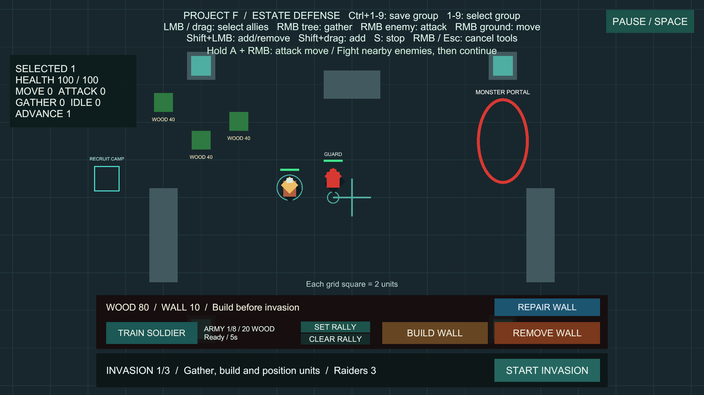
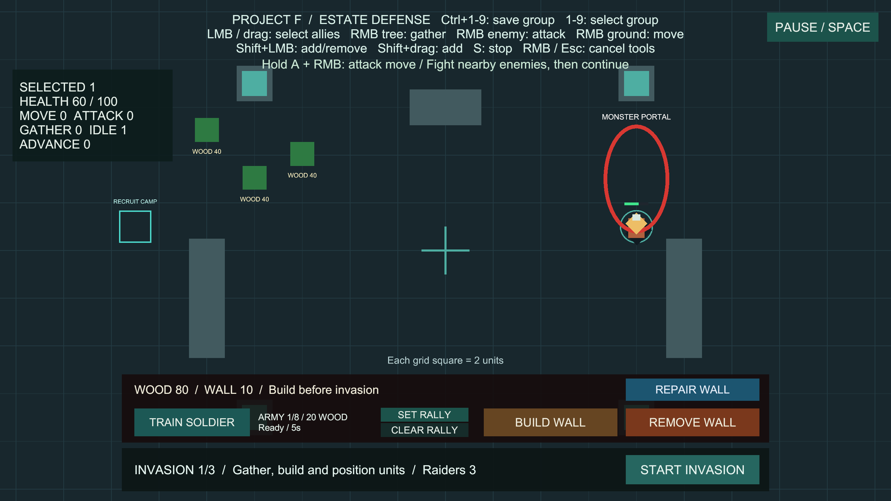

# 아군 공격 이동

상태: 사용자 승인·main 병합 완료. 구현 `7faa959`, main 병합 `2a2dfe0`. 브랜치 `codex/attack-move`에서 구현했고 GitHub에 반영했습니다.

## 사용법

추가 준비 없이 **Project F → Open Gameplay → Play**로 실행합니다.

1. 병사를 좌클릭·드래그 또는 부대 번호로 선택합니다.
2. **A를 누른 채 목적지 땅을 우클릭**합니다. A만 누르면 명령이 나가지 않습니다.
3. 병사는 이동 중 주변의 보이는 적을 찾아 공격합니다. 교전이 끝나면 처음 지정한 목적지로 계속 이동합니다.
4. 왼쪽 위 **ADVANCE**는 공격 이동 명령을 수행 중인 선택 병사 수입니다. 그 명령으로 교전 중인 병사도 포함합니다.
5. 일반 땅 우클릭·적 우클릭·나무 우클릭으로 다른 명령을 주거나 **S**로 정지할 수 있습니다.

## 규칙

- 기본 탐지 반경은 6입니다. 몸 중심 거리와 시야를 검사해 가까운 적을 선택합니다. 지형·벽 너머의 적과 아군·중립·죽은 대상은 새로 선택하지 않습니다.
- 교전 시작 위치에서 병사 또는 적이 기본 8을 넘겨 벗어나거나, 이동·타격 진전이 3초간 없으면 추격을 끝냅니다. 1초간 원래 경로를 진행한 뒤 다시 탐지할 수 있습니다.
- 목적지 도착 또는 길찾기 실패 시 공격 이동은 종료됩니다. 도착 후 상시 경계·자동 추격 태세는 부여하지 않습니다.
- A+우클릭은 해당 지점을 공격 이동 목적지로 사용합니다. 특정 적 공격·나무 채집은 A를 떼고 우클릭합니다.
- 기존 선택·충돌 회피·집결 이동 규칙을 사용합니다. 훈련소 집결 지점은 기존 일반 이동으로 유지됩니다.
- 일시정지는 명령과 대상·목적지를 보관합니다. UI 위, 건설·집결 도구가 입력을 사용하는 동안, 패닝·드래그·일시정지에서는 새 공격 이동을 내리지 않습니다.
- 일반 이동은 기존처럼 자동 적 탐지를 하지 않습니다. 병사의 사망·공격 이동 컴포넌트 비활성화 시 자동 행동을 종료하며 씬 재시작에는 명령이 초기화됩니다.

## 설정과 유지보수

**Project F → Select Attack Move Settings**에서 공용 설정을 선택합니다.

| 설정 | 기본값 | 의미 |
| --- | --- | --- |
| Detection Radius | 6 | 새 교전 대상 탐지 거리 |
| Pursuit Radius | 8 | 교전 시작 위치 기준 추격 한계, 탐지 거리 이상 |
| Scan Interval | 0.25초 | 이동 중 탐지 주기 |
| Stalled Seconds | 3초 | 이동·타격 진전 없이 기다릴 최대 시간 |
| Recovery Seconds | 1초 | 교전 종료 후 원래 경로를 진행할 시간 |

느린 공격 주기로 밸런스를 바꿀 때는 Stalled Seconds가 정상 공격 대기시간보다 충분히 길도록 함께 조정하세요.

- `AttackMoveOrder`는 목적지·탐지·추격 전환을 소유합니다. 피해·사거리·공격 주기는 `UnitCombat`, 실제 경로와 충돌 회피는 `NavigationWorld2D`가 계속 담당합니다.
- 기존 이동·정지·공격·채집 이벤트로 명령을 대체합니다. 내부 자동 공격은 플레이어의 직접 공격과 구분하여 자기 명령을 취소하지 않습니다.
- 이동 중 0.25초 간격으로 주변 물리 영역만 탐지하고 결과 목록을 재사용합니다. 첫 탐지 시점을 유닛별로 분산하며 비활성 명령·교전 중에는 새 대상을 검색하지 않습니다.
- 추격 한계를 전투 물리 처리보다 먼저 확인하도록 기존 적 AI와 같은 방식으로 실행 순서를 지정했습니다.
- `AttackMoveSetup`이 초기 아군 4명·병사 프리팹·공용 설정·UI 안내를 연결합니다. 씬·프리팹·설정은 Unity API로 저장하며 패키지·프로젝트 설정은 변경하지 않습니다.
- 선택 패널은 공격 이동을 ADVANCE 한 범주로 집계합니다. 나머지 MOVE/ATTACK/GATHER/IDLE과 중복 계산하지 않습니다.

## 검증

- 공격 이동 전용 PlayMode 13개 통과, 실패·건너뜀·판정 불가 0개, 14.85초. 자동 탐지·시야·근접 대상 선택·교전 후 복귀·추격 제한·정체·도착·명령 교체·일시정지·충원·재시작·실제 입력·여러 병사 명령·UI/건설 도구 차단을 확인했습니다.
- 기존 추가 선택 검사에서 `(-16, 5)`가 확장된 상태 패널 안에 들어간 것을 화면 좌표로 확인했습니다. 해당 좌표를 쓰던 이동·선택 해제·Shift 빈 땅 클릭을 모두 `(-12, -4)`로 옮겼고, 공통 지도 클릭 도우미에서 UI 밖인지 먼저 검증하도록 보완했습니다. 최종 전체 검사에서 관련 12개도 모두 통과했습니다.
- 실제 Play에서 다른 아군을 잠시 비활성화하고 적 하나를 생성해, 병사 선택 → A+우클릭 `(8, 1)` → 주변 적 자동 교전 → 적 사망 → 원래 목적지 도착을 확인했습니다. 도착 좌표 `(8, 1)`, 생존 적 0, 체력 60/100, 선택 유지, ADVANCE 0·IDLE 1입니다. 검증용 배치는 Play 종료와 함께 제거했습니다.
- 최종 전체 PlayMode **255개 통과**(기존 242개 + 공격 이동 13개), 실패·건너뜀·판정 불가 0개, 321.76초. 로컬 기록: `Logs/advance-tests-final.json`, `Logs/advance-tests-final.xml`.
- Windows x64 빌드 성공, 오류 0개, 13.696초, 132,878,314바이트. 이전 일시정지 빌드와 동일한 경고 유형 501건(AI 셰이더 500건, Pipeline 안내 1건)이며 새 경고 유형은 없습니다.
- `Builds/AttackMove/ProjectF_AttackMove.exe`의 화면 없는 시작 검사에서 엔진·입력 초기화, 프로세스 유지, 로그 오류·예외 0건을 확인했습니다. 키·마우스 입력과 화면은 Editor Play에서 검증했습니다.
- 최종 BasicCombat 저장·Play 중지. 누락 스크립트·공격 이동/선택 참조 0개, 초기 아군 공격 이동 4개·충원 프리팹 1개·EventSystem 1개, 현재 Console 오류 0개입니다. 기존 `Assets/_Recovery` 백업은 로컬에 보존하고 커밋에서 제외합니다.

### 실제 Play 화면

자동 교전 중 ADVANCE 1:

교전 종료 후 원래 목적지 도착, ADVANCE 0·IDLE 1:

