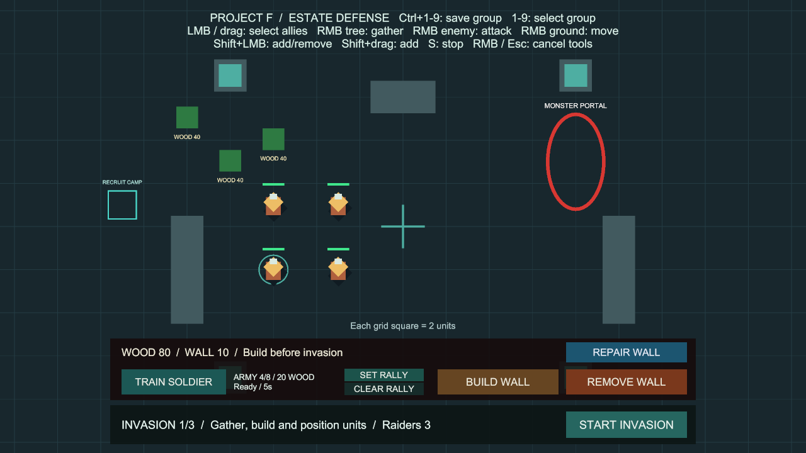
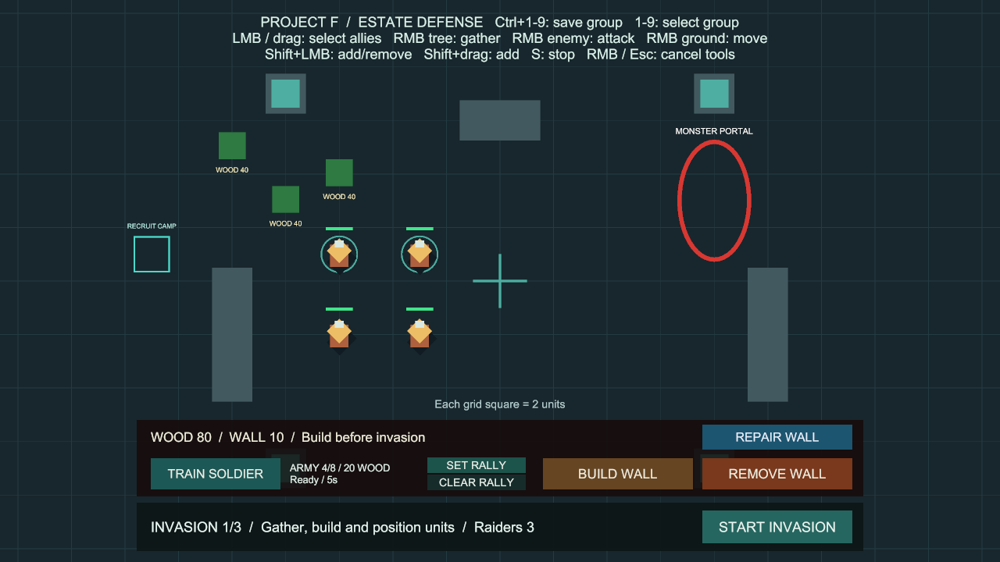

# 부대 번호 저장·호출

상태: 구현·검증 완료, 사용자 확인 대기. 브랜치 `codex/control-groups`, 승인된 정지 명령의 main 병합 `567f4ee`에서 분기했습니다. 사용자 최종 확인 후 main에 병합합니다.

## 사용법

추가 준비 없이 **Project F → Open Gameplay → Play**로 실행합니다.

1. 좌클릭·드래그·Shift 추가 선택으로 병사를 고릅니다.
2. 마우스를 지도 위에 두고 **Ctrl + 1**을 눌러 1번 부대에 저장합니다.
3. 다른 병사를 선택한 뒤 **1**을 누르면 저장한 병사들이 다시 선택됩니다. 선택 원으로 확인할 수 있습니다.
4. **2~9**에도 각각 다른 구성을 저장할 수 있습니다. 같은 병사를 여러 번호에 포함할 수 있습니다.
5. 호출 후 땅·적·나무를 우클릭하면 해당 병사들에게 이동·공격·채집 명령을 내립니다.

| 조작 | 동작 |
| --- | --- |
| Ctrl + 1~9 | 현재 선택을 해당 번호에 저장·교체 |
| 1~9 | 저장된 구성원으로 선택 교체 |
| 아무도 선택하지 않고 Ctrl + 번호 | 해당 번호 비우기 |
| 비어 있는 번호 호출 | 현재 선택 해제 |

- 키보드 위쪽 숫자 1~9와 양쪽 Ctrl을 지원합니다. 숫자 패드·0번은 사용하지 않습니다.
- 저장·호출은 기존 이동·공격·채집을 취소하지 않습니다. Shift를 함께 눌러 호출해도 선택을 교체합니다. 카메라는 이동하지 않습니다.
- 저장 후 선택을 바꿔도 저장된 구성은 유지됩니다. 사망·파괴·비활성·비아군 병사는 호출 시 구성원에서 제외합니다. 제외된 병사가 다시 활성화되면 다시 선택해 저장해야 합니다.
- 새로 훈련한 병사도 저장할 수 있습니다. 전투와 다음 차수 준비에서도 같은 번호를 사용할 수 있습니다.
- 저장 내용은 현재 씬의 플레이 동안만 유지합니다. 입력·컨트롤러를 잠시 비활성화해도 유지하지만 RESTART·씬 재시작·Play 종료 시 초기화합니다.
- UI 위·게임 화면 밖, 드래그 선택·카메라 패닝, 건설·철거·수리·집결 지정, 일시정지·입력 비활성화 중에는 단축키를 무시합니다. 지도 위로 돌아와 키를 놓았다가 다시 누르세요.
- 길게 누르기는 반복하지 않습니다. 숫자를 동시에 누르면 작은 번호를 처리합니다. 같은 프레임의 S 정지가 먼저이며, 부대 단축키는 우클릭 명령보다 먼저 처리합니다.
- 이번 단계는 선택 단축키입니다. 영웅 지휘력·편대 유지·부대 AI·영구 저장·부대별 상태 HUD는 후속 범위입니다.

## 코드와 유지보수

- `CommandInput`: 기존 액션 맵에 Ctrl과 9개 숫자 액션을 추가합니다. 매 프레임 고정된 9개 입력만 검사하며 누른 순간의 슬롯을 전달합니다.
- `UnitCommandController`: 기존 선택 목록·HashSet·선택 가능 여부·포인터 점유·UI 보호를 재사용합니다. 각 번호에 독립된 목록을 보관하고 저장 시 내용을 복사합니다.
- 목록은 초기화 때 한 번 생성해 재사용합니다. 구성원 검사는 호출할 때만 수행하며 매 프레임 전체 부대 검색·LINQ·새 목록 생성을 추가하지 않습니다. 처음 큰 구성을 저장할 때는 목록 용량이 확장될 수 있습니다.
- 저장·호출은 유닛의 행동 명령 API를 부르지 않습니다. 정지·전투·채집·길찾기와 별도로 선택 상태만 갱신합니다.
- BasicCombat 안내문과 `WoodGatheringSetup`의 생성 안내를 함께 갱신했습니다. 새 컴포넌트·패키지·설정 에셋·Inspector 연결은 없습니다.

## 검증

Unity 6000.6.0f1 / Windows x64 / 2026-10-11 (Asia/Seoul).

- 기준: 정지 명령 전체 검사 197개 통과, Windows 빌드 오류 0개·기존 경고 501건.
- 실제 Input System 입력을 쓰는 전용 PlayMode **13개 통과**, 실패·건너뜀·판정 불가 0개, **4.33초** (`Logs/groups-tests-targeted.json`).
- 9개 슬롯·양쪽 Ctrl, 독립 구성·교체·해제, 명령 유지·호출 후 지휘 범위, 사망·파괴·비활성 정리, 길게 누르기, 동시 입력 우선순위, UI·도구·드래그·패닝·일시정지, 컨트롤러 재활성화·씬 재시작, 충원 병사를 검사합니다.
- 기본 설정 BasicCombat Play에서 위쪽 두 병사를 드래그로 선택 → Ctrl+1 → 다른 병사 선택 → 1 호출을 실제 입력 경로로 수행했습니다. 저장된 Lord·Test Unit 2의 선택 복원과 선택 원, 1280×720 화면의 안내문을 확인했습니다. 임시 입력 장치를 제거하고 Play를 종료했습니다.
- 최종 전체 PlayMode **210개 통과**(기존 197개 + 부대 번호 13개), 실패·건너뜀·판정 불가 0개, **273.49초** (`Logs/groups-tests-final.json`).
- Windows x64 빌드 성공, **오류 0개**, **12.695초**, **132,863,058바이트**. 경고 501건의 유형은 이전 정지 명령 빌드와 동일합니다(AI inference 셰이더와 Player의 Pipeline 비활성화 안내).
- `Builds/ControlGroups/ProjectF_ControlGroups.exe`의 화면 없는 시작 검사에서 엔진·입력 초기화와 프로세스 유지를 확인했습니다. 시작 로그 오류·예외는 없습니다. 게임 화면·키 입력은 위 Editor Play에서 검증했습니다.
- 최종 BasicCombat은 저장·Play 중지 상태입니다. 누락 스크립트 0개, 선택 컨트롤러 참조 누락 0개, EventSystem 1개, 현재 콘솔 오류 0개. 패키지·프로젝트 설정·프리팹 변경은 없습니다.
- 원본 기록: `Logs/groups-tests-targeted.json`, `Logs/groups-tests-final.json`, `Logs/groups-build-final.json`, `Logs/groups-scene-final.json`, `Logs/ControlGroups-player.log`. Logs·Builds는 로컬 산출물이며 Git에는 코드·씬·검사·사용법·화면을 보관합니다.

