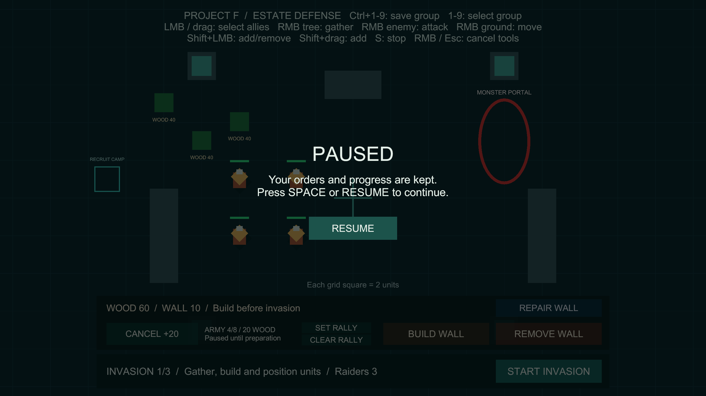
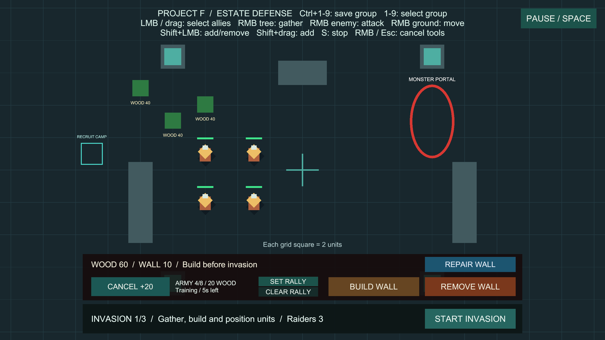

# 일시정지·재개

상태: 구현·검증 완료, 사용자 확인 대기. 브랜치 `codex/game-pause`, 승인된 훈련 취소의 main 병합 `0bf400a`에서 분기했습니다. 사용자 확인 후 main에 병합합니다.

## 사용법

추가 설정 없이 **Project F → Open Gameplay → Play**로 실행합니다. 키보드는 Game 창에 포커스를 둔 상태에서 사용하세요.

1. 병사에게 이동·공격·채집 명령을 내리거나 훈련·침공을 시작합니다.
2. **Space** 또는 오른쪽 위 **PAUSE / SPACE**를 누릅니다.
3. 화면 중앙에 **PAUSED**와 **RESUME**이 나타나고 게임 시간이 멈춥니다.
4. **Space**를 다시 누르거나 **RESUME**을 클릭하면 이어집니다.

## 동작 규칙

| 항목 | 일시정지 중 동작 |
| --- | --- |
| 병사 이동·전투 | 위치·공격 대상·명령·공격 대기시간 보관 |
| 목재 채집 | 채집 대상·누적 작업 시간 보관, 목재 지급 정지 |
| 훈련·침공 | 남은 훈련·준비·생성 간격 보관 |
| 선택·지도 명령 | 기존 선택 유지, 새 명령·S 정지·부대 번호 입력 차단 |
| 카메라 | 드래그 이동·줌 정지 |
| 건설·훈련·침공 버튼 | 정지 화면이 클릭을 차단, 재개 후 사용 |
| 건설·집결 지정 도구 | 진행 중인 지정 모드 종료, 이미 만든 벽·집결 지점 유지 |

Space를 길게 눌러도 한 번만 전환합니다. Esc는 기존 도구 취소 키로 유지합니다. 정지 중 명령 예약, 배속 선택, 자동 포커스 이탈 정지, 저장 메뉴는 이번 범위에 포함하지 않습니다.

## 코드와 유지보수

- `GamePause`: 씬 소유 시간 제어. 정지 직전의 `Time.timeScale`을 보관하고 0으로 만듭니다. 컴포넌트 비활성·씬 종료 시 자신이 소유한 정지를 해제합니다. 이미 외부에서 멈춘 시간은 인수하지 않으며, 외부가 바꾼 시간 값도 재개 시 덮어쓰지 않습니다.
- `CommandInput`: 기존 액션 맵에 Space 입력 하나를 추가합니다. 활성·비활성·포커스·해제 수명 관리가 기존 입력과 같습니다.
- `UnitCommandController.SetPointerCommandsBlocked`: 기존 소유자별 입력 차단을 재사용합니다. 재개 시 누르고 있던 마우스 버튼을 뗄 때까지 지도 명령이 새어 나가지 않도록 기존 보호가 적용됩니다.
- `PauseHUD`: 상태 변경 이벤트 때만 화면을 갱신하며 버튼 이벤트를 대칭으로 등록·해제합니다. 전체 화면 입력 차단 이미지와 기존 Canvas를 사용합니다.
- `StrategyCamera2D`: 시간이 멈추면 진행 중인 패닝도 종료합니다. 이동·전투·채집의 기존 FixedUpdate와 시간 기준을 재사용하므로 각 유닛에 별도 정지 처리를 추가하지 않습니다.
- `GamePauseSetup`: 기존 BasicCombat에 구성 요소와 UI를 한 번 추가하는 Editor 도구입니다. 반복 실행은 중복 오브젝트를 만들지 않습니다. 씬 변경은 Unity API로 저장했습니다.
- 패키지·프로젝트 설정 변경은 없습니다. 정지 상태는 저장 데이터가 아니며 새 게임은 실행 상태로 시작합니다. 멀티플레이 시간 제어는 범위 밖입니다.

## 검증

- 2026-10-13 전용 PlayMode **11개 통과**, 실패·건너뜀·판정 불가 0개, 12.57초.
- 실제 Space의 1회 전환·길게 누르기, PAUSE/RESUME 클릭, HUD 재활성화, 이동·선택·명령 보관, 훈련·환불 잠금, 채집 대상·시간 보관, 침공 준비·생성 정지, 근접 피해 정지, 도구 취소, 카메라 고정, 비활성·외부 시간 값·씬 재시작을 검사했습니다.
- 실제 Editor Play에서 5초 훈련 시작 후 Space로 정지했습니다. 남은 시간 4.8828373초와 목재 60이 유지되고 Space 재개 후 남은 시간이 줄어드는 것을 확인했습니다. 정지·재개 화면도 확인했습니다.
- 최종 전체 PlayMode **242개 통과**(기존 231개 + 일시정지 11개), 실패·건너뜀·판정 불가 0개, 297.52초. 로컬 기록: `Logs/pause-tests-final.json`, `Logs/pause-tests-final.xml`.
- Windows x64 빌드 성공, 오류 0개, 13.798초, 132,873,114바이트. 이전 훈련 취소 빌드와 같은 경고 유형 501건이며 새 경고 유형은 없습니다. AI 셰이더 관련 500건과 Pipeline 안내 1건입니다.
- `Builds/GamePause/ProjectF_GamePause.exe`의 화면 없는 시작 검사에서 엔진·입력 초기화, 프로세스 유지, 로그 오류·예외 0건을 확인했습니다. 버튼·Space 입력과 화면은 Editor Play에서 검증했습니다.
- 최종 BasicCombat 저장·Play 중지. 누락 스크립트·선택/HUD/훈련/일시정지 참조 0개, EventSystem과 GamePause 각 1개, 정지 화면은 초기 숨김 상태입니다. 기존 `Assets/_Recovery` 백업은 로컬에 보존하고 커밋에서 제외합니다.

