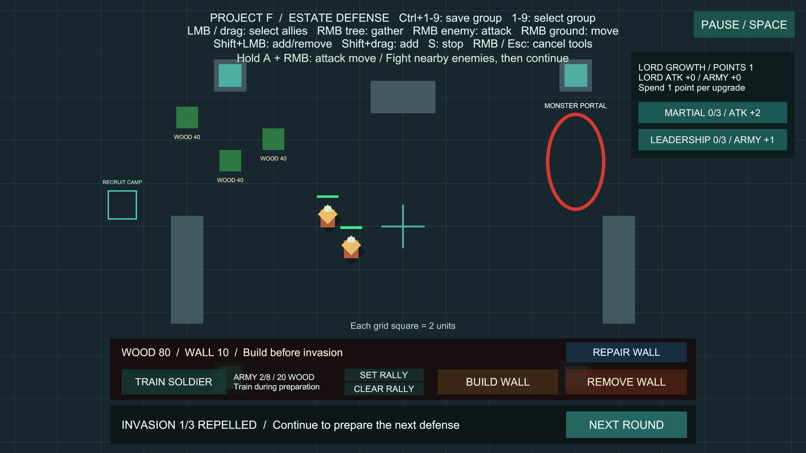
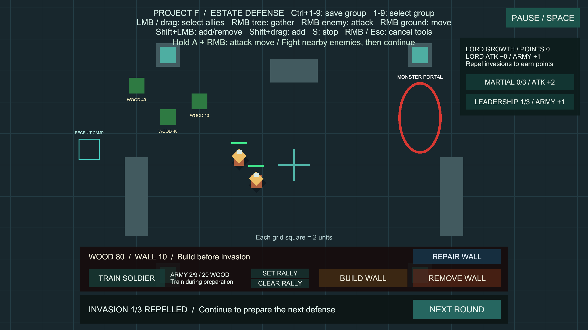

# 영주 성장 포인트

상태: 구현·검증 완료, 사용자 확인 대기. 브랜치 `codex/lord-growth`, 승인된 병사 숙련도의 main 병합 `f84079a`에서 분기했습니다. 사용자 확인 후 main에 병합합니다.

## 사용법

추가 준비 없이 **Project F → Open Gameplay → Play**로 실행합니다.

1. 영주가 살아 있는 상태로 침공을 격퇴하면 오른쪽 위 **LORD GROWTH / POINTS**에 포인트 1개가 추가됩니다.
2. 격퇴 결과 화면이나 다음 차수 준비 중에 **MARTIAL** 또는 **LEADERSHIP**을 누릅니다. 클릭 한 번에 포인트 1개를 소비합니다.
3. MARTIAL(무력)은 영주 공격력 +2, LEADERSHIP(통솔)은 병력 상한 +1을 줍니다. 기본 영주 공격력 15, 초기 병력 상한 8입니다.
4. 각 계열은 기본 3단계입니다. 자유롭게 나누어 투자하거나 포인트를 보관할 수 있습니다. 현재 3차 침공에서는 총 3포인트를 획득하므로 양쪽을 모두 끝까지 올릴 수 없습니다.
5. 아래 훈련소의 ARMY 표시에서도 변경된 상한을 확인합니다. 통솔은 다음 병사를 훈련할 공간을 늘리며, 병사를 자동 생성하지 않습니다.

## 규칙과 범위

- 기획서 4~5장의 행동·업적 기반 영주 성장의 첫 단계입니다. 이번 업적은 차수별 침공 격퇴이며 보상은 차수마다 한 번입니다. 일반 공격·채집·대기·실패·침공 취소에는 포인트가 없습니다.
- 영주가 죽은 뒤 다른 병사가 격퇴해도 성장 포인트를 주지 않습니다. 현재 게임은 영주의 사망만으로 패배하지 않습니다.
- 준비 또는 격퇴 상태, 생존 영주, 게임 진행 중일 때만 투자합니다. 침공 진행·일시정지·영주 사망·컴포넌트 비활성화에서는 투자할 수 없습니다.
- 구매한 보너스와 남은 포인트는 다음 차수까지 유지합니다. 이미 투자한 통솔의 병력 상한은 영주 사망이나 일시적 비활성화로 줄지 않습니다. 비활성화 중 놓친 과거 차수의 보상은 소급 지급하지 않습니다.
- 다시 활성화했을 때 현재 차수가 격퇴 상태이고 영주가 살아 있다면 해당 차수의 미수령 보상을 한 번 확인합니다. 이미 받은 차수는 다시 지급하지 않습니다.
- 무력은 영주에게만 적용되며 일반 병사의 숙련도·공용 전투 설정은 바꾸지 않습니다. 통솔은 같은 영지 훈련소에 연결합니다. 전체 병력 상한은 기존 64명 제한을 지킵니다.
- 새 병사에는 영주 성장 컴포넌트를 붙이지 않습니다. RESTART 시 포인트·투자·보너스가 초기화됩니다. 디스크 저장, 투자 취소·환불, 다른 성장 계열, 영웅 성장, 부대별 지휘력·사기는 이후 범위입니다.
- 수치는 현재 프로토타입 밸런스입니다.

## 설정과 유지보수

**Project F → Select Lord Growth Settings**에서 설정을 선택합니다.

| 설정 | 기본값 | 의미 |
| --- | --- | --- |
| Points Per Victory | 1 | 차수별 격퇴 보상 |
| Maximum Rank | 3 | 각 계열의 투자 상한 |
| Damage Per Rank | 2 | 무력 1단계당 영주 공격력 증가 |
| Capacity Per Rank | 1 | 통솔 1단계당 병력 상한 증가 |

- `LordGrowth`가 포인트·투자·보상 차수를 소유합니다. 기존 `PortalInvasion.Changed` 이벤트를 구독하며 별도의 Update나 전체 유닛 검색이 없습니다. 보상 차수를 먼저 기록한 뒤 알리고, 투자 중 재진입을 차단합니다. 값이 실제 바뀔 때만 알림을 보내므로 씬 종료 중 다른 객체를 불필요하게 깨우지 않습니다.
- `LordGrowthSettings`는 밸런스 데이터입니다. 플레이 상태를 공용 에셋에 저장하지 않습니다.
- `UnitCombat.AttackDamage`에 영주의 보너스를 합산하고 `UnitRecruitment.MaximumAllies`로 훈련 시작·완료 시 상한을 동일하게 검사합니다. 기존 씬에 영주 성장 참조가 없으면 원래 상한을 사용합니다.
- `LordGrowthHUD`는 표시와 버튼만 담당합니다. 값 변경 이벤트와 투자 가능 여부가 바뀔 때 표시를 갱신하며 매 프레임 문자열·목록을 생성하지 않습니다. 패널은 지도 입력을 차단하고 일시정지 덮개보다 아래에 배치합니다.
- `LordGrowthSetup`이 Unity API로 영주·훈련소·설정·HUD를 연결합니다. **Project F → Setup → Add Lord Growth**는 저장된 BasicCombat·Play 중지 상태에서만 실행하며 이미 연결된 경우 중복 생성하지 않습니다.

## 검증

- 최종 전용 PlayMode 13개 통과, 실패·건너뜀·판정 불가 0개, 4.41초. 차수별 중복 보상, 실패/취소, 실제 피해량, 병력 상한 해제 후 실제 충원, 단계 상한·잘못된 입력, 일시정지·침공, 사망·비활성화, 재시작, 이벤트 재진입, 실제 버튼 입력과 지도 선택 보호, 불필요한 수명주기 알림 차단을 확인했습니다.
- 첫 전체 검사에서 278개 중 17개가 실패했습니다. 16개는 씬 종료 중 불필요한 성장 알림이 이미 제거된 자원 창고를 참조한 문제로, 값 변경 때만 알리도록 고쳤습니다. 이를 확인하는 수명주기 회귀 검사를 추가했습니다.
- 나머지 1개는 재시작 후 마우스를 움직이지 않으면 선택 좌표가 `(0, 0)`에 남는 입력 초기화 문제였습니다. 고정 커서 재현 검사 실패를 확인한 뒤 `CommandInput`의 Pointer 액션에 초기 상태 읽기를 활성화했습니다. 선택 패널 9개 재검사 통과(6.88초).
- 최종 전체 PlayMode **279개 통과**(기존 266개 + 영주 성장 13개), 실패·건너뜀·판정 불가 0개, **346.03초**. 이전 실패는 모두 해소했습니다.
- BasicCombat 저장·Play 중지 상태에서 누락 스크립트·성장/HUD 참조 0개. LordGrowth와 HUD 각 1개, 훈련소 연결, 충원 프리팹 성장 제외·숙련도 유지, EventSystem 1개, 일시정지 덮개 아래 배치 확인. 설치 메뉴를 다시 실행해도 씬 변경·중복 생성이 없습니다.
- Windows x64 빌드 성공, 오류 0개, 18.579초, 132,890,650바이트. 경고 501건은 이전 빌드와 같은 경고 첫 줄이며 AI inference 셰이더 500건과 Pipeline 런타임 설정 안내 1건입니다. 셰이더 변형 세부 목록은 일부 다릅니다. 현재 Editor 컴파일 실패 없음·Console 오류 0개.
- `Builds/LordGrowth/ProjectF_LordGrowth.exe`를 화면 없이 실행해 12초간 프로세스 유지, 엔진·입력 초기화, 시작 로그 오류·예외 0개를 확인했습니다. 그래픽 화면 검증은 아래 Editor Play 기록이며 실행 파일 시작 검사는 렌더링 성능 검증이 아닙니다.
- 실제 Play에서 기본 전투·성장 설정으로 첫 차수 격퇴 시 POINTS 1 지급을 확인했습니다. 화면 확인용 전투는 남은 적 AI·반격을 임시로 끈 뒤 생존 병사의 실제 공격으로 마무리했습니다. 화면의 LEADERSHIP 버튼을 직접 눌러 POINTS 1→0, 통솔 0→1, ARMY 상한 8→9 갱신을 확인했습니다. 보상이나 투자 값을 직접 설정하지 않았습니다. 임시 입력 장치는 제거하고 Play 종료로 검증용 전투 변경을 정리했습니다.

## 로컬 검증 기록

- `Logs/lord-growth-targeted-final.json`, `Logs/lord-growth-selection-final.json`
- `Logs/lord-growth-tests-final.json`, `Logs/lord-growth-tests-final.xml`
- `Logs/lord-growth-tests-before-fix.xml`, `Logs/lord-growth-pointer-before-fix.json`
- `Logs/lord-growth-scene-final.json`, `Logs/lord-growth-console-final.json`
- `Logs/lord-growth-build-final.json`, `Logs/lord-growth-player-final.json`, `Logs/LordGrowth-player.log`

로그와 빌드는 기존 Git 제외 규칙에 따라 로컬에 보관합니다. 코드·씬·설정·검사·문서·확인 화면은 기능 브랜치에 포함합니다. 기존 씬 복구 백업은 보존하고 커밋에서 제외합니다.
