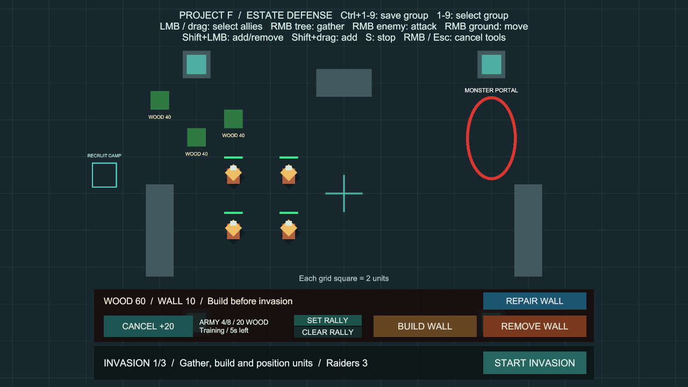
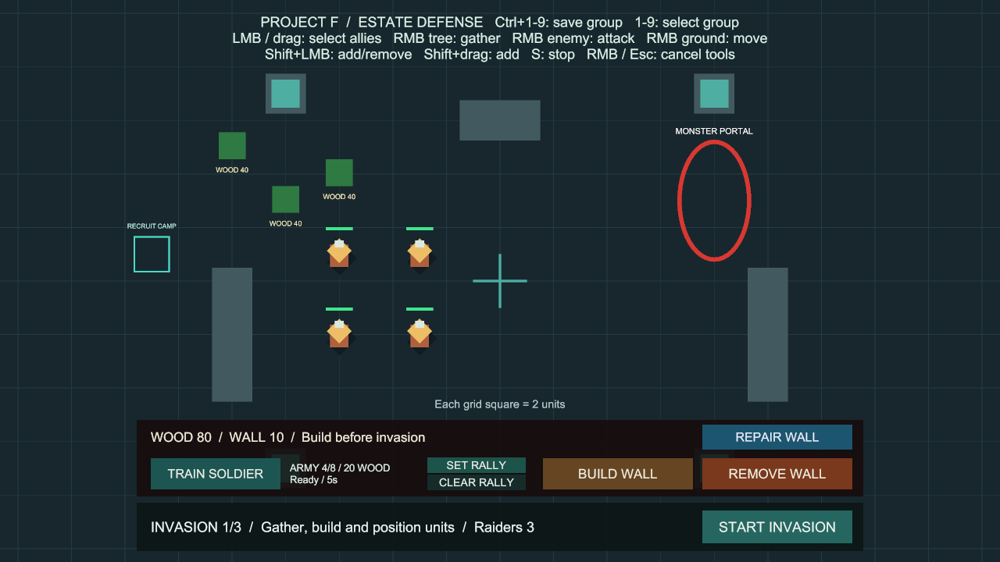

# 훈련 취소·목재 환불

상태: 사용자 승인 완료. 구현 `15b2eeb`, main 병합 `0bf400a`, GitHub 반영 완료. 브랜치 `codex/recruitment-cancel`은 승인된 상태 패널의 main 병합 `54feab2`에서 분기했습니다.

## 사용법

추가 준비 없이 **Project F → Open Gameplay → Play**로 실행합니다.

1. 준비 단계에서 **TRAIN SOLDIER**를 누릅니다. 기본 목재 20을 지불하고 5초 훈련을 시작합니다.
2. 병사가 나오기 전에 같은 위치의 **CANCEL +20**을 누릅니다.
3. 훈련 슬롯과 남은 시간이 비워지고 목재 20을 돌려받습니다. 버튼은 TRAIN SOLDIER로 돌아옵니다.
4. 다시 훈련하면 현재 설정의 비용을 지불하고 전체 훈련 시간부터 시작합니다.

## 규칙

- 환불액은 훈련을 시작할 때 실제 지불한 금액입니다. 훈련 중 설정 비용이 바뀌어도 기존 환불액은 유지합니다.
- 준비 단계에서 훈련 중이거나 출구·병력 상한 때문에 배치를 기다리는 슬롯을 취소할 수 있습니다.
- 침공·결과 화면·일시정지에서는 취소할 수 없습니다. 다음 준비 단계에 돌아오면 다시 가능합니다.
- 이미 나온 병사는 취소 대상이 아닙니다. 기존 병사의 선택·이동·공격·채집, 훈련소 집결 지점도 유지합니다.
- 자원 저장소가 비활성이거나 정수 상한 때문에 전액 환불할 수 없으면 취소를 거절하고 슬롯·남은 시간·결제 금액을 유지합니다. 저장 여건이 회복되면 다시 취소할 수 있습니다.
- 재시작은 영지와 훈련 상태를 처음으로 돌립니다. 이전 슬롯의 환불이 중복 지급되지 않습니다.

## 코드와 유지보수

- `UnitRecruitment`: `CancellationRefund`, `CanCancelTraining`, `TryCancelTraining`으로 표시와 실행을 분리합니다. 최초 결제 금액을 슬롯에 보관하고 취소·배치 때 함께 지웁니다.
- `EstateStockpile`: 내부 환불 메서드는 금액 검증 → 목재 추가 → 훈련 슬롯 정리 → 변경 이벤트 순서로 처리합니다. 자원 관찰자가 이미 취소된 슬롯을 다시 환불하지 못하도록 상태를 먼저 확정합니다. 기존 공개 자원 추가 API는 유지합니다.
- 결제·취소가 진행되는 동안 같은 슬롯의 재구매·재취소를 막습니다. HUD의 활성/비활성 전환에서 버튼 이벤트를 정확히 구독·해제합니다.
- `RecruitmentHUD`: 기존 버튼을 훈련/취소로 전환합니다. 자원·훈련 이벤트와 초 단위 표시 갱신을 재사용합니다. 훈련 중 취소 가능 여부는 상수 시간으로 확인하며 매 프레임 병력 목록을 새로 조사하지 않습니다.
- 씬·프리팹·패키지·프로젝트 설정 변경과 새 오브젝트가 없습니다. 저장 기능과 훈련 대기열은 이번 범위에 포함하지 않습니다.

## 검증

- 전용 PlayMode 12개 통과, 실패·건너뜀·판정 불가 0개, 4.82초.
- 취소 후 미배치, 중복 환불 방지, 원래 결제 금액, 재훈련 시간, 자원 이벤트 재진입, 정수 상한, 출구·병력 상한 대기, 준비 단계 잠금, 비활성·일시정지, 배치 후 취소 거절, 실제 클릭, 선택·명령·집결 유지, HUD 재활성화, 씬 재시작을 검사했습니다.
- 기본 설정의 Editor Play에서 실제 훈련·취소 버튼을 클릭하고 목재 80→60→80, 병력 4명 유지, 버튼·안내 복귀를 확인했습니다.
- 2026-10-12 최종 전체 PlayMode **231개 통과**(기존 219개 + 훈련 취소 12개), 실패·건너뜀·판정 불가 0개, 280.57초. CLI 상태가 실행 중으로 남아 Unity가 기록한 최종 XML과 Editor 완료 로그로 결과를 교차 확인했습니다. 로컬 기록: `Logs/cancel-tests-final.xml`, `Logs/cancel-tests-final.json`.
- Windows x64 빌드 성공, 오류 0개, 12.470초, 132,866,674바이트. 이전 선택 상태 패널 빌드와 같은 경고 유형 501건이며 새 경고 유형은 없습니다. AI 셰이더 관련 500건과 Pipeline 안내 1건입니다.
- `Builds/RecruitmentCancel/ProjectF_RecruitmentCancel.exe`의 화면 없는 시작 검사에서 엔진·입력 초기화, 프로세스 유지, 로그 오류·예외 0건을 확인했습니다. 실제 버튼과 화면은 Editor Play에서 검증했습니다.
- 최종 BasicCombat을 저장된 상태로 열고 Play를 중지했습니다. 누락 스크립트·선택/HUD/훈련 참조 0개, EventSystem 1개입니다. 이전 세션의 `Assets/_Recovery` 백업은 로컬에 보존하고 커밋에서 제외합니다.

