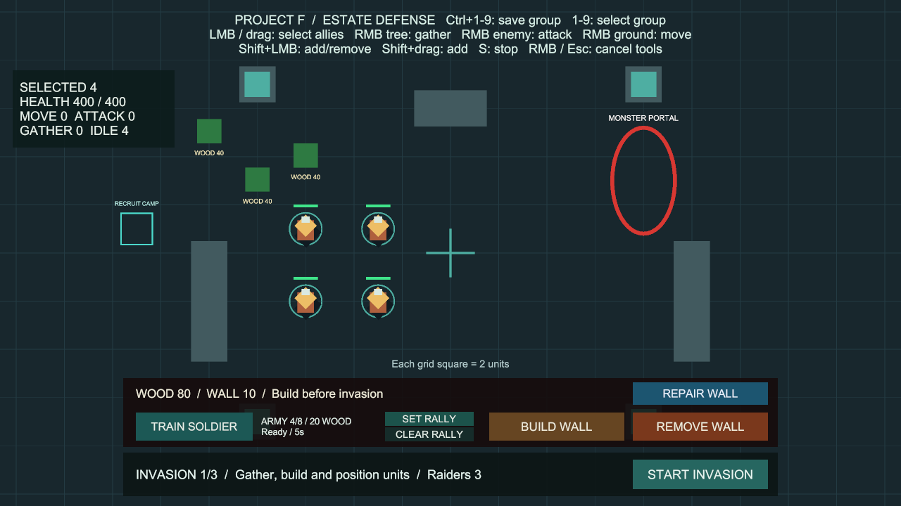
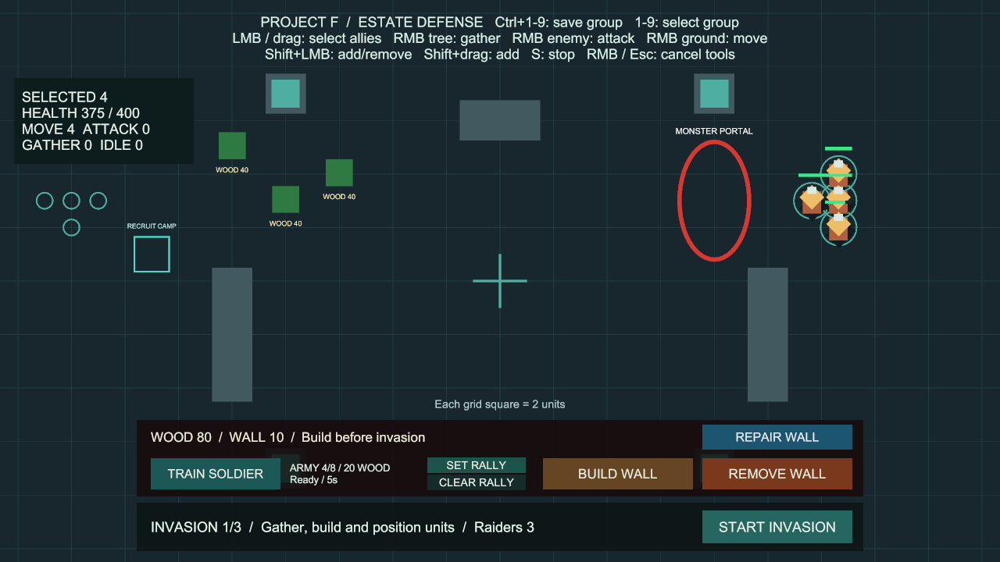

# 선택 병사 상태 패널

상태: 구현·검증 완료, 사용자 확인 대기. 브랜치 `codex/selection-status`, 승인된 부대 번호의 main 병합 `8f6eaa3`에서 분기했습니다. 사용자 최종 확인 후 main에 병합합니다.

## 사용법

추가 준비 없이 **Project F → Open Gameplay → Play**로 실행합니다.

1. 병사를 좌클릭하거나 여러 병사를 드래그로 선택합니다.
2. 화면 왼쪽 위 상태 패널에서 선택 인원과 체력 합계를 확인합니다.
3. 땅·적·나무를 우클릭하면 해당 명령 인원이 갱신됩니다. S로 정지하면 대기로 바뀝니다.
4. Shift 선택이나 저장한 부대 번호로 선택을 바꿔도 패널이 자동으로 갱신됩니다. 빈 땅 클릭 등으로 선택을 해제하면 패널이 숨겨집니다.

| 표시 | 의미 |
| --- | --- |
| SELECTED | 현재 선택한 아군 수 |
| HEALTH | 선택한 아군의 현재 체력 합계 / 최대 체력 합계 |
| MOVE | 일반 이동 명령을 수행 중인 인원 |
| ATTACK | 적 공격 명령을 수행 중인 인원. 추격·접근 포함 |
| GATHER | 목재 채집 명령을 가진 인원. 접근·채집·저장고가 가득 찬 상태의 대기 포함 |
| IDLE | 위 명령이 없는 인원 |

- 한 병사는 하나의 명령 범주에만 포함됩니다. 실제 공격 애니메이션 중인 인원이나 초당 생산량을 나타내는 수치는 아닙니다.
- 경로 정체 등으로 채집 명령이 취소되면 IDLE로 표시합니다. 실패 원인별 상세 표시는 후속 범위입니다.
- 체력은 합계이므로 개별 부상 정도를 보려면 병사 한 명을 선택하세요. 이 기능은 회복이나 능력치 변경을 하지 않습니다.
- 최대 0.1초 간격으로 갱신합니다. 게임 시간이 멈춘 상태에서도 표시는 갱신됩니다. 새 일시정지 조작은 이번 범위에 포함하지 않습니다.
- 사망·제거·비활성화된 병사는 제외하며, 새로 훈련한 병사는 선택하는 즉시 포함합니다.
- 보이는 패널 위에서는 지도 선택·우클릭 명령·S·부대 번호 단축키를 차단합니다. 지도 위로 마우스를 옮겨 지휘하세요.
- 체력 컴포넌트가 없는 이동 전용 유닛만 연결한 경우 HEALTH는 N/A입니다. 현재 BasicCombat의 모든 병사에는 체력이 있습니다.

## 코드와 유지보수

- `Runtime/Input/SelectionStatusHUD.cs`: 기존 `UnitCommandController.Selected`, `UnitCombat`, `WoodGatherer`, `CommandableUnit`을 읽는 표시 전용 컴포넌트입니다. 행동 명령과 선택 로직은 변경하지 않았습니다.
- 선택한 병사만 0.1초마다 순회합니다. 매 프레임 전체 씬 검색, 새 목록, LINQ, 유닛별 이벤트 구독을 추가하지 않습니다. 숫자가 변했을 때만 문자열을 만들어 UI 재구성을 줄입니다. 체력 합계는 long으로 누적합니다.
- `Editor/SelectionStatusSetup.cs`: 기존 Canvas에 루트·패널·텍스트를 추가하고 참조를 연결합니다. **Project F → Setup → Add Selection Status**는 저장된 BasicCombat·Play 중지 상태에서 사용할 수 있으며, 이미 있으면 아무것도 추가하지 않습니다. 현재 씬에는 연결이 완료되어 실행할 필요가 없습니다.
- `BasicCombat.unity`: 기존 Command HUD 아래 상태 패널만 추가했습니다. 선택이 없으면 배경과 클릭 영역을 함께 숨깁니다. HUD 루트는 갱신을 위해 활성 상태를 유지합니다.
- Inspector의 commands·panel·status 참조를 유지하세요. 위치·크기·폰트는 Selection Status/Panel/Status에서 조절할 수 있습니다. 기존 Canvas 설정·프리팹·패키지·입력 바인딩은 변경하지 않았습니다.

## 검증

Unity 6000.6.0f1 / Windows x64 / 2026-10-12 (Asia/Seoul).

- 기준: 부대 번호 전체 210개 통과, Windows 빌드 오류 0개·기존 경고 501건.
- 실제 Input System 입력을 사용하는 전용 PlayMode **9개 통과**, 실패·건너뜀·판정 불가 0개, **6.88초** (`Logs/status-tests-targeted.json`).
- 빈 선택·복수 선택 합계, 피해·사망·비활성·파괴, 혼합 명령·정지, 부대 번호·Shift, 패널 클릭 차단, 일시정지 표시, HUD 비활성·재활성화, 씬 재시작, 새 병사를 검사합니다.
- 실제 Play에서 드래그로 4명을 선택해 400/400·대기 4명 표시를 확인했습니다. 검증용 피해 25를 적용한 뒤 375/400 갱신과 우클릭 이동 시 MOVE 4 표시를 확인했습니다. 1280×720 화면에서 글자 잘림·겹침이 없음을 확인하고 임시 입력 장치를 제거한 뒤 Play를 종료했습니다.
- 씬 구성 메뉴를 다시 실행해 HUD가 1개로 유지되고 씬이 변경되지 않는 것을 확인했습니다.
- 첫 전체 실행에서 218개 통과·1개 실패가 있었습니다. 기존 추가 드래그 검사의 빈 지도 좌표가 새 패널 아래에 있어 정상적인 UI 차단에 걸렸습니다. 빈 지도 좌표를 옮기고 드래그 시작점이 UI 밖인지 검사하도록 보완했습니다. 관련 선택 검사 **12개 재검사 통과**, 3.48초 (`Logs/status-selection-retest.json`). 런타임 선택 규칙은 변경하지 않았습니다.
- 최종 전체 PlayMode **219개 통과**(기존 210개 + 상태 패널 9개), 실패·건너뜀·판정 불가 0개, **279.46초** (`Logs/status-tests-final.json`).
- Windows x64 빌드 성공, **오류 0개**, **14.238초**, **132,866,130바이트**. 경고 501건의 유형은 이전 부대 번호 빌드와 동일합니다(AI inference 셰이더와 Player의 Pipeline 비활성화 안내).
- `Builds/SelectionStatus/ProjectF_SelectionStatus.exe`의 화면 없는 시작 검사에서 엔진·입력 초기화와 프로세스 유지를 확인했습니다. 시작 로그 오류·예외 없음. 실제 화면과 조작은 위 Editor Play에서 검증했습니다.
- Editor 재실행 후 BasicCombat을 다시 열어 저장·Play 중지 상태, HUD 1개, EventSystem 1개, 누락 스크립트·HUD/선택 참조 0개, 현재 콘솔 오류 0개를 확인했습니다. 시작 시 발견한 이전 세션 백업은 `Assets/_Recovery`에 로컬 보존하고 기능 커밋에서 제외했습니다.
- 원본 기록: `Logs/status-tests-targeted.json`, `Logs/status-selection-retest.json`, `Logs/status-tests-final.json`, `Logs/status-build-final.json`, `Logs/status-scene-final.json`, `Logs/SelectionStatus-player.log`. Logs와 Builds는 로컬 산출물입니다.

