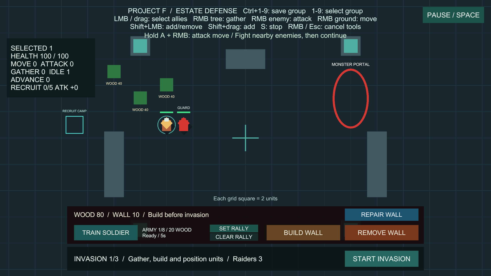
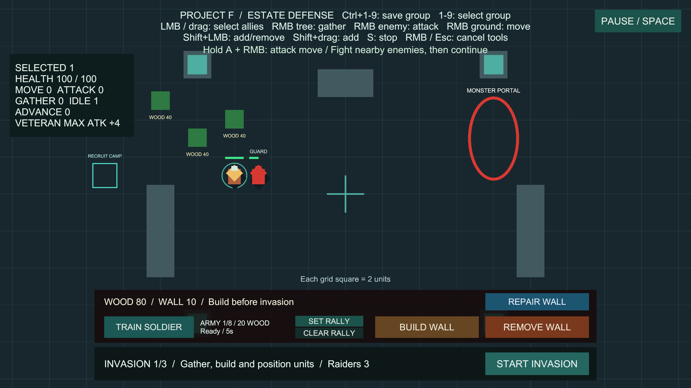

# 병사 전투 숙련도

상태: 사용자 승인 완료. 구현 `867af91`, main 병합 `f84079a`, GitHub 반영 완료. 브랜치 `codex/soldier-proficiency`, 승인된 공격 이동의 main 병합 `2a2dfe0`에서 분기했습니다.

## 사용법

추가 준비 없이 **Project F → Open Gameplay → Play**로 실행합니다.

1. 영주 이외의 일반 병사를 선택하고 적을 우클릭하거나 A+우클릭으로 공격 이동합니다.
2. 적에게 실제 공격을 명중시킬 때마다 숙련도가 1 증가합니다. 마지막 처치 타격도 1회입니다.
3. 5회 명중하면 **TRAINED**, 15회 명중하면 **VETERAN**이 됩니다. 공격력 보너스는 각각 +2, +4입니다. 기본 공격력 15인 병사는 15 → 17 → 19가 됩니다.
4. 선택 패널의 마지막 줄에서 `RECRUIT 0/5 ATK +0`, `TRAINED 5/15 ATK +2`, `VETERAN MAX ATK +4`를 확인합니다.
5. 여러 병사를 선택하면 `SKILL R / T / V`에 신병·숙련병·베테랑 인원이 표시됩니다. 영주만 선택하면 `PROFICIENCY N/A`입니다.

## 규칙과 범위

- 초기 일반 병사 3명과 새 충원 병사에게 적용합니다. 영주의 성장 포인트와 적의 능력치는 별도로 유지합니다.
- 단계에 도달한 타격은 기존 공격력으로 처리하고, **다음 타격부터** 보너스를 적용합니다. 체력·공격 속도·사거리·이동 속도는 숙련도로 변하지 않습니다.
- 공격 명령 클릭, 접근, 막힌 공격, 피격, 채집으로는 숙련도가 오르지 않습니다. 공격 주기는 기존 전투 규칙을 그대로 사용합니다.
- 숙련도는 병사 개인에게 귀속됩니다. 다른 병사와 공유하지 않으며 살아남은 병사는 다음 침공에도 유지합니다. 최고 단계에서는 15로 누적을 멈춥니다.
- 일시정지 동안 진행도와 공격을 보관합니다. 컴포넌트 비활성화 중에는 획득과 보너스를 중단하고, 재활성화 시 기존 진행도를 사용합니다.
- 새 충원 병사와 RESTART 후에는 0부터 시작합니다. 사망한 병사의 숙련도를 다른 병사에게 이전하지 않습니다.
- 이는 기획서 8장의 **병사 숙련도 기반**입니다. 연구·시설·장비·지휘 영웅을 요구하는 병종 전환, 영주/영웅 성장, 디스크 저장은 이후 기능입니다. 명중 횟수와 보너스는 현재 프로토타입 밸런스입니다.

## 설정과 유지보수

**Project F → Select Proficiency Settings**에서 공용 설정을 선택합니다.

| 설정 | 기본값 | 의미 |
| --- | --- | --- |
| Trained Hits | 5 | 숙련 단계에 필요한 누적 명중 횟수 |
| Veteran Hits | 15 | 베테랑 단계에 필요한 누적 명중 횟수 |
| Trained Damage Bonus | 2 | 숙련 단계의 추가 피해 |
| Veteran Damage Bonus | 4 | 베테랑 단계의 추가 피해 |

- `SoldierProficiency`가 개인 진행도·단계·보너스를 소유합니다. 기존 `UnitCombat.Attacked` 이벤트를 구독하므로 별도의 Update나 대상 검색이 없습니다.
- `UnitCombat.AttackDamage`가 기본 설정과 해당 병사의 보너스를 합산합니다. 공용 CombatSettings 에셋을 수정하지 않습니다. 큰 설정값의 덧셈도 범위를 넘지 않도록 제한합니다.
- 선택 패널은 기존 0.1초 갱신을 사용하며 선택한 유닛만 확인합니다.
- `ProficiencySetup`은 Unity API로 초기 일반 병사와 충원 프리팹, 공용 설정, 패널 높이를 연결합니다. 새 병사 유형에도 같은 컴포넌트와 설정을 붙일 수 있습니다. 활성화 전에 프리팹 구성을 완료해야 합니다.

## 검증

- 전용 PlayMode 10개 통과, 실패·건너뜀·판정 불가 0개, 20.51초. 경계 타격/다음 타격 피해량·개인 설정 분리·최고 단계 상한·반복 클릭·처치 타격·막힘/거리·비활성 재활성·일시정지·실제 입력과 표시·충원/재시작·다음 침공 유지 확인. 이후 공격 이동 연동 검사 1개를 추가했습니다.
- 기본 병사 설정의 실제 Play에서 우클릭 공격으로 숙련도 0 → 5 → 15, 공격력 15 → 17 → 19를 확인했습니다. 검증용 적 하나만 체력을 500으로 늘리고 반격을 껐으며, 화면을 확인할 수 있도록 5/15회에 정지시켰습니다. 적 체력은 500 → 425 → 255로 실제 피해 계산과 일치했습니다. 검증용 배치·입력 장치·복제 설정은 정리했습니다.
- 첫 전체 검사에서 265개 통과·1개 실패가 있었습니다. 부대 번호 검사의 지도 명령 좌표가 숙련도 행으로 넓어진 선택 패널에 가려져 정상적인 UI 차단에 걸렸습니다. 해당 좌표와 같은 위치를 쓰던 동시 입력 검사를 빈 땅으로 옮기고 UI 밖인지 확인하도록 보완했습니다. 부대 번호 13개 재검사 통과, 6.11초. 게임 명령 처리 코드는 변경하지 않았습니다.
- 최종 전체 PlayMode **266개 통과**(기존 255개 + 숙련도 11개), 실패·건너뜀·판정 불가 0개, **343.37초**. 2026-10-15 Unity 최종 XML과 CLI 완료 결과를 대조했습니다.
- Windows x64 빌드 성공, 오류 0개, 19.076초, 132,881,914바이트. 이전 공격 이동 빌드와 같은 경고 유형 501건(AI 셰이더 500건, Pipeline 안내 1건)입니다.
- `Builds/SoldierProficiency/ProjectF_SoldierProficiency.exe`의 화면 없는 시작에서 엔진·입력 초기화와 프로세스 유지, 로그 오류·예외 0건을 확인했습니다. 실제 입력과 화면은 Editor Play에서 검증했습니다.
- Editor 재실행과 최종 검사 후 BasicCombat 저장·Play 중지, 누락 스크립트·숙련도/선택 패널 참조 0개, 현재 콘솔 오류 0개를 확인했습니다. 초기 일반 병사 3명·충원 프리팹 1개에 숙련도 연결, 영주에는 미부착, EventSystem 1개입니다. 마지막 수정은 테스트 좌표뿐이므로 기존 Windows 빌드와 실제 플레이 검증의 런타임 코드·에셋은 동일합니다.
- 원본 기록은 `Logs/proficiency-tests-targeted.json`, `Logs/proficiency-tests-before-fix.xml`, `Logs/proficiency-control-groups-retest.json`, `Logs/proficiency-tests-final.json`, `Logs/proficiency-tests-final.xml`, `Logs/proficiency-build-final.json`, `Logs/proficiency-scene-final.json`, `Logs/Proficiency-player.log`에 보관합니다. Logs와 Builds는 로컬 검증 산출물이며 화면 3장은 문서와 함께 버전 관리합니다.

### 실제 Play 화면

