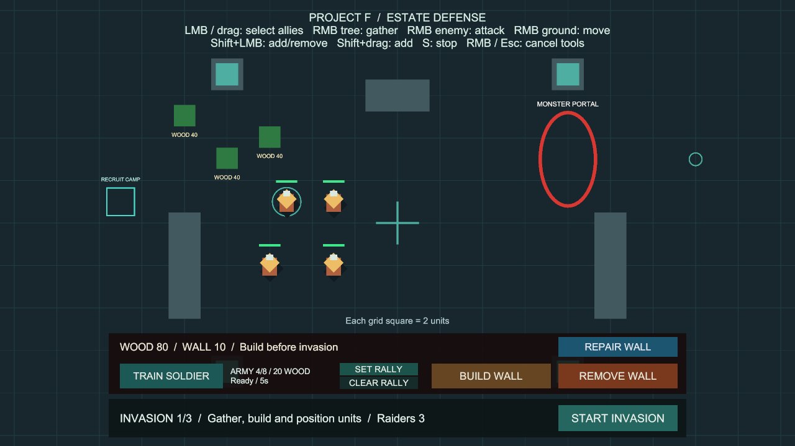
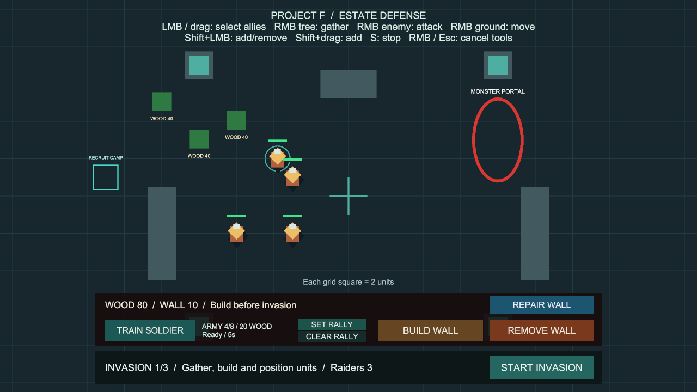

# 선택 병사 정지 명령

상태: 구현·검증 완료, 사용자 확인 대기. 브랜치 `codex/unit-stop-command`, 승인된 추가 선택의 main 병합 `2c8ea7c`에서 분기했습니다. 사용자 확인 후 main에 병합합니다.

## 사용법

추가 준비 없이 **Project F → Open Gameplay → Play**로 실행합니다.

1. 좌클릭·드래그 또는 Shift 추가 선택으로 병사를 고릅니다.
2. 마우스를 지도 위에 두고 **S**를 누릅니다.
3. 선택한 병사의 이동·추격·공격·목재 채집이 취소되고 목적지 표시가 사라집니다. 선택은 유지합니다.
4. 땅·적·나무를 우클릭하면 다시 이동·공격·채집합니다.

- 선택하지 않은 병사의 명령은 유지합니다. 선택이 없으면 아무 명령도 내리지 않습니다.
- S는 누르는 순간 한 번 처리합니다. 계속 누른 상태에서도 이후 새 명령은 실행할 수 있으며, 다시 멈추려면 S를 놓았다가 누릅니다.
- 같은 프레임에 S와 우클릭을 입력하면 정지를 우선합니다.
- UI 위·화면 밖, 드래그 선택 중·가운데 버튼 카메라 이동 중, 건설·철거·수리·집결 지정 중에는 무시합니다. 도구를 종료하고 지도 위에서 다시 누르세요.
- 일시정지나 입력 비활성화 중에는 무시하며, 입력을 저장해 나중에 실행하지 않습니다.
- 이미 지급된 채집 자원은 유지하고 진행 중인 채집 주기는 취소합니다. 다시 채집하면 새 주기를 시작합니다. 공격 대기시간은 초기화하지 않습니다.
- 이것은 현재 명령의 취소입니다. 영구적인 위치 사수·자동 반격 금지 태세·명령 예약은 포함하지 않습니다. 전투 가능 상태와 적 AI의 기존 규칙을 유지합니다.

## 코드와 유지보수

- `CommandInput`: 기존 액션 맵의 S 바인딩, 누른 프레임만 전달합니다.
- `UnitCommandController`: 기존 선택·입력 점유·UI 보호 규칙을 적용하고 선택한 아군에만 정지를 전달합니다.
- `CommandableUnit.StopCommand`: 플레이어 정지 이벤트를 보낸 뒤 속도·목적지 표시를 정리합니다. 중앙 길찾기에 새 명령을 알려 주변 병사가 정지한 병사를 고려해 다시 계획하도록 합니다.
- `UnitCombat`, `WoodGatherer`: 정지 이벤트를 구독해 각자 소유한 공격·채집 명령을 취소합니다. 활성화·비활성화 때 구독을 대칭으로 관리합니다.
- 내부 `Stop`은 도착·공격 거리 유지·채집 접근 완료에 계속 사용합니다. 이 내부 정지는 다른 행동을 취소하는 플레이어 이벤트를 보내지 않습니다.
- 선택 목록·기존 길찾기와 행동 취소 API를 재사용합니다. 새 전역 관리자, 매 프레임 검색, 설정 에셋·패키지는 추가하지 않습니다.
- BasicCombat 상단 조작 안내와 생성 코드에 S 안내만 추가했습니다. UI 크기·위치·클릭 영역과 저장 데이터 형식은 유지합니다.

## 검증

Unity 6000.6.0f1 / Windows x64 / 2026-10-11 (Asia/Seoul).

- 기준: 추가 선택 전체 검사 186개 통과, Windows 빌드 오류 0개·기존 경고 501건.
- 실제 Input System 마우스·키보드를 사용하는 전용 검사는 선택·미선택 병사, 추격 취소·재개, 채집 취소·재개, 길게 누르기, 동시 우클릭, UI·화면 밖·일시정지·입력 비활성, 모든 건설 모드·집결 지정, 드래그·패닝, 공격 대기시간, 재활성화 구독·사망을 다룹니다.
- 전용 PlayMode **11개 통과**, 실패·건너뜀 0개, **9.85초** (`Logs/stop-tests-targeted.json`).
- 기본 설정 BasicCombat Play에서 실제 입력 경로로 Lord 선택 → (14, 3) 땅 우클릭 → 이동 중 S를 수행했습니다. Moving/목적지 있음에서 Idle/목적지 없음으로 전환, 속도 (0, 0), 선택 유지와 목적지 표시 제거를 확인했습니다. 두 화면을 확인하고 임시 입력 장치를 제거한 뒤 Play를 종료했습니다.
- 최종 전체 PlayMode **197개 통과**(기존 186개 + 정지 명령 11개), 실패·건너뜀·판정 불가 0개, **270.00초** (`Logs/stop-tests-final.json`).
- Windows x64 빌드 성공, **오류 0개**, **12.914초**, **132,861,954바이트**. 경고 501건의 유형은 이전 추가 선택 빌드와 동일합니다(AI inference 셰이더와 Player의 Pipeline 비활성화 안내).
- `Builds/StopCommand/ProjectF_StopCommand.exe`의 화면 없는 시작 검사에서 엔진·입력 초기화와 프로세스 유지를 확인했습니다. 시작 로그 오류·예외는 없습니다. 게임 화면과 키 입력은 위 Editor Play 검증으로 확인했습니다.
- 최종 BasicCombat은 저장·Play 중지 상태입니다. 누락 스크립트 0개, 선택 컨트롤러 참조 누락 0개, EventSystem 1개. 패키지·프로젝트 설정·프리팹 변경은 없습니다.
- 원본 기록: `Logs/stop-tests-targeted.json`, `Logs/stop-tests-final.json`, `Logs/stop-build-final.json`, `Logs/stop-scene-final.json`, `Logs/StopCommand-player.log`. Logs와 Builds는 로컬 검사 산출물이며 Git에는 코드·씬·검사·사용법·화면을 보관합니다.

